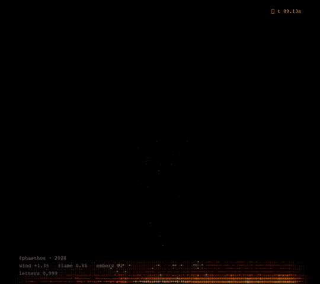
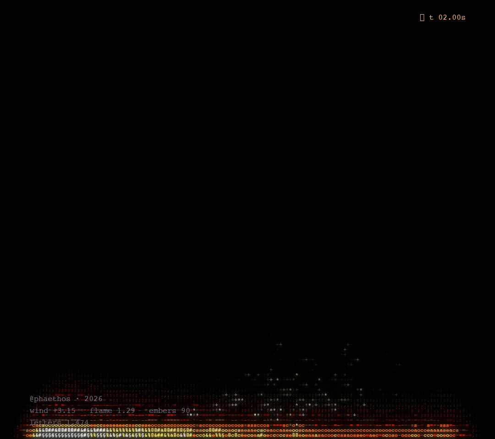
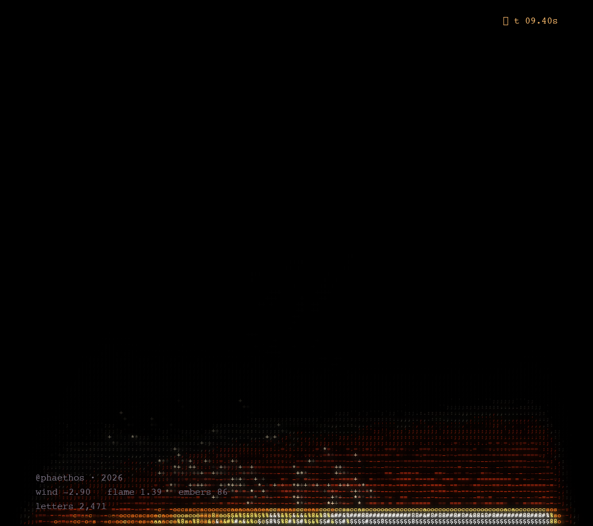
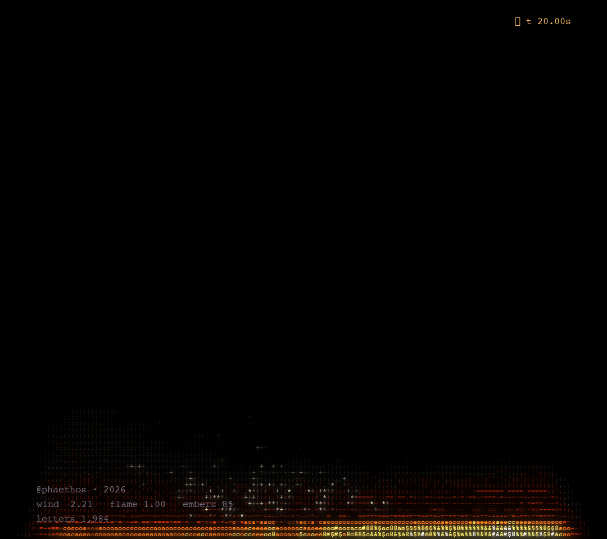

# FIRE

Fire · ASCII code art by phaethos, 2026 · a fork addition, drawn in the spirit of JIN2



## Artist's Note

After the classic fire effect from the demoscene (early 1990s), kept honest:
heat is injected at the bottom, every cell asks its three neighbours below
what is left of their warmth, and the answer cools as it climbs.
Wind slides the bed of coals, and embers ride up out of the flames.
Everything is drawn only with letters, numbers and symbols.

| ignite | blaze | coals |
|---|---|---|
|  |  |  |

## Technology

Python · NumPy · pygame-ce

## Creative Process

1. Reference: the classic fire propagation trick - one of the oldest
   and most loved effects in demoscene history. This piece is a port of
   that idea into letters, with credit to the original technique.
2. The source is a bed of coals along the bottom edge, breathing,
   sliding slowly with the wind.
3. Embers are particles that spawn in the flames, ride up and die out.
4. Above the fire, the leftover warmth becomes smoke.

## Technical Concepts

Cellular heat propagation (average of three below) · subtractive cooling
Sub-cell wind advection · particle embers · phosphor trail and glow pass

## Source Code

The full Python source is free and included in this folder.

```
pip install -r requirements.txt
python fire.py
```

Space pause, R restart, S screenshot, Esc quit.
Free for personal projects. Please credit phaethos if you share what you make. See LICENSE.txt.

---

Artist: phaethos · [github.com/phaethos](https://github.com/phaethos)
© 2026 phaethos. All rights reserved.
