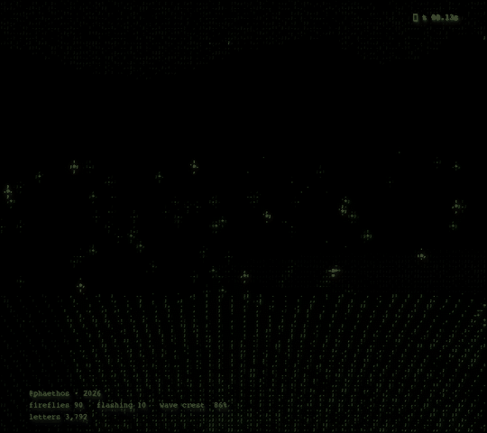
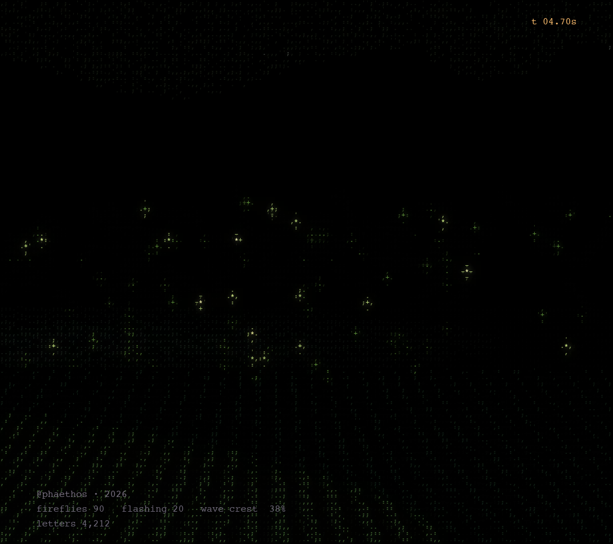
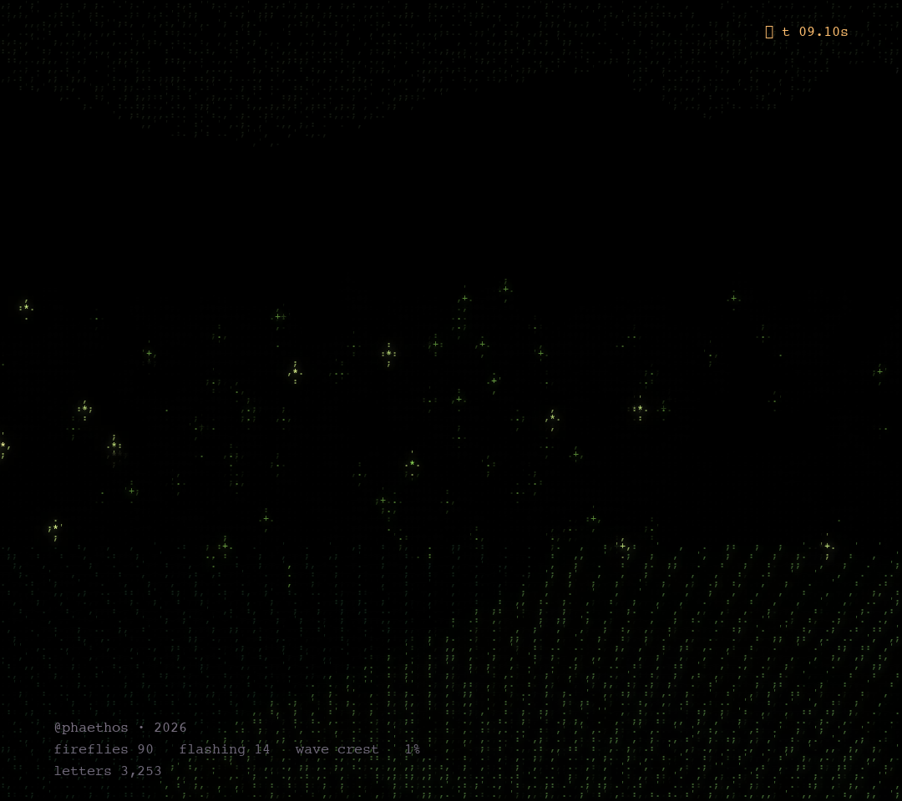
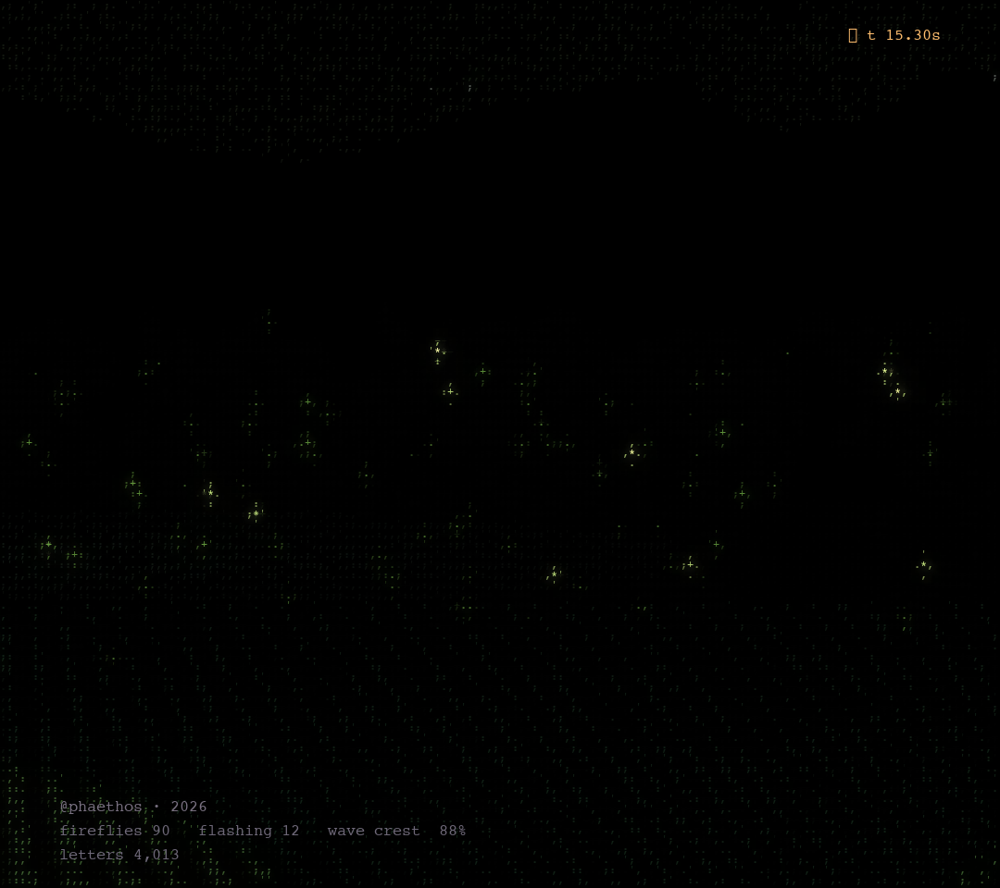

# FIREFLY FIELD

Firefly Field · ASCII code art by phaethos, 2026 · a fork addition, drawn in the spirit of JIN2



## Artist's Note

A jungle night. Grass sways at the bottom, mist drifts over the tips,
leaves hang in from the corners, and ninety fireflies breathe light.
Some keep their own rhythm. Some flash together, a wave of light
crossing the field, the way real colonies of synchronous fireflies do.
Everything is drawn only with letters, numbers and symbols.

| the field | the wave | night |
|---|---|---|
|  |  |  |

## Technology

Python · NumPy · pygame-ce

## Creative Process

1. Reference: recordings of synchronous fireflies (for example in southeast
   asia) - not every individual is in step, but a travelling wave of flashes
   crosses the colony.
2. Each firefly is a wanderer with its own pulse period; the synchronous
   ones share a rhythm with a phase offset across the field, which makes
   the wave.
3. The grass is stripes of blades, sheared sideways by a slow sway,
   with pale tips.

## Technical Concepts

Particle wanderers with Lissajous drift · phase-locked subpopulation
Travelling phase wave · sheared blade field · phosphor trail and glow pass

## Source Code

The full Python source is free and included in this folder.

```
pip install -r requirements.txt
python firefly_field.py
```

Space pause, R restart, S screenshot, Esc quit.
Free for personal projects. Please credit phaethos if you share what you make. See LICENSE.txt.

---

Artist: phaethos · [github.com/phaethos](https://github.com/phaethos)
© 2026 phaethos. All rights reserved.
