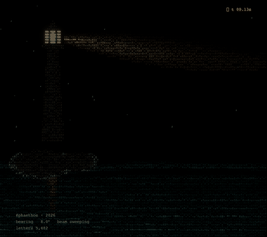
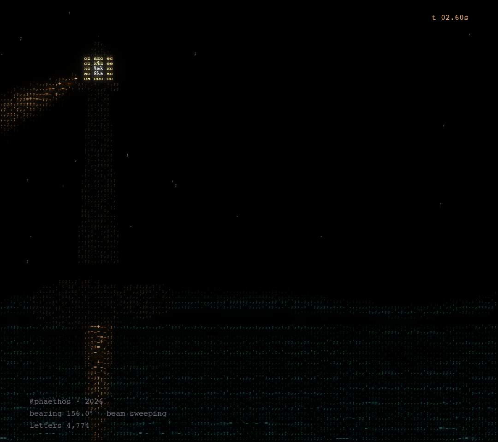
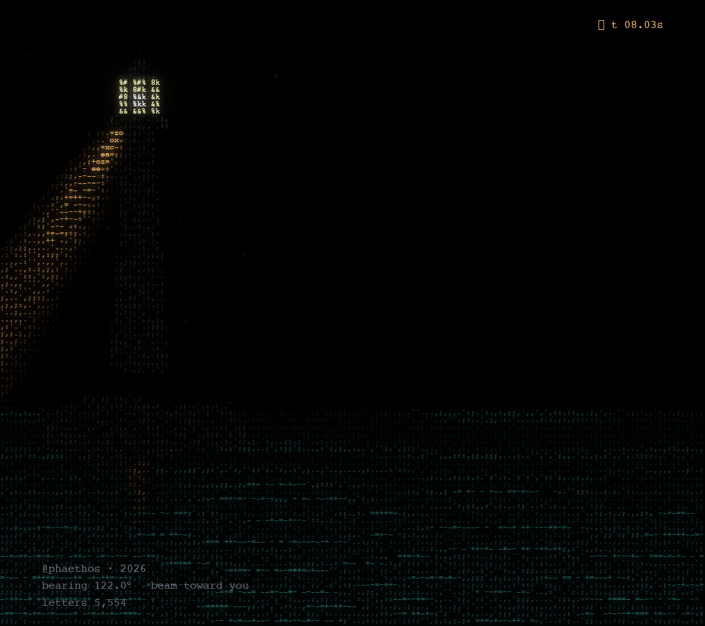
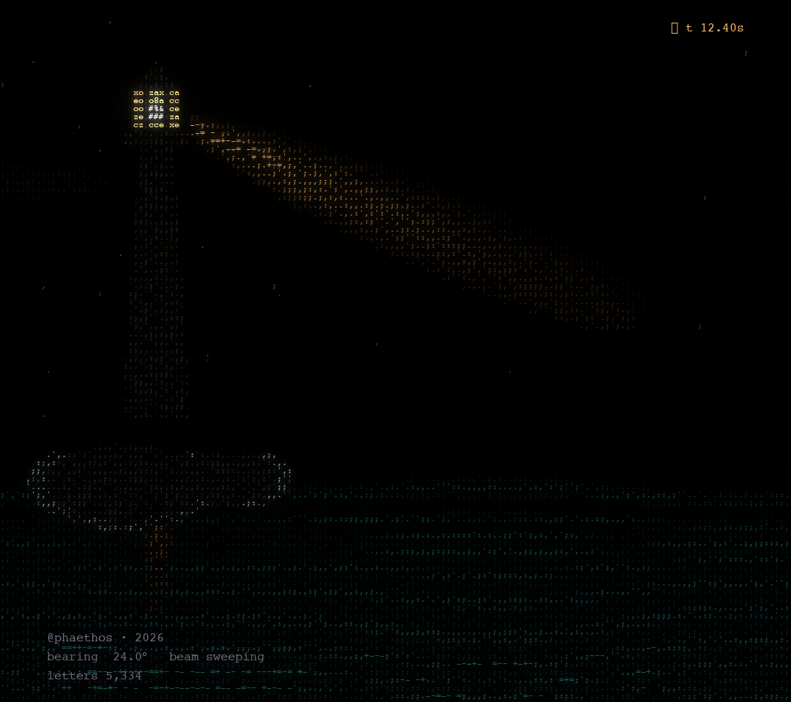

# LIGHTHOUSE

Lighthouse · ASCII code art by phaethos, 2026 · a fork addition, drawn in the spirit of JIN2



## Artist's Note

A lamp on a rocky point turns its beam over dark water.
The beam paints the air, the sea keeps the light a moment after it passes,
and every few seconds the lamp swings past you and the whole scene lifts.
Everything is drawn only with letters, numbers and symbols.

| the beam | the flash | the sea |
|---|---|---|
|  |  |  |

## Technology

Python · NumPy · pygame-ce

## Creative Process

1. Reference: photographs of real lighthouses at night - the beam as a cone,
   the glitter path on the water, the tower as a silhouette.
2. The beam is a cone of light on a slow turn: every cell asks how far off
   the beam's angle it sits, and the answer fades with distance.
3. The sea is foam lines riding toward you, spaced wider as they come close,
   with sparkle from a hash of the cell.
4. When the beam crosses the direction of the viewer, the lamp flares and
   the whole frame lifts a little.

## Technical Concepts

Per-cell field rendering (no meshes) · angular gaussian beam cone · 1/d falloff
Perspective-scaled foam lines · hash-based glitter · phosphor trail and glow pass

## Source Code

The full Python source is free and included in this folder.

```
pip install -r requirements.txt
python lighthouse.py
```

Space pause, R restart, S screenshot, Esc quit.
Free for personal projects. Please credit phaethos if you share what you make. See LICENSE.txt.

---

Artist: phaethos · [github.com/phaethos](https://github.com/phaethos)
© 2026 phaethos. All rights reserved.
