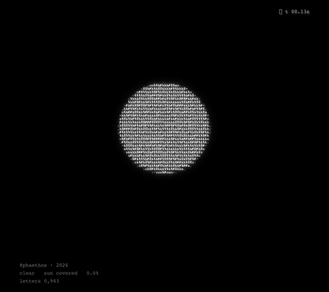
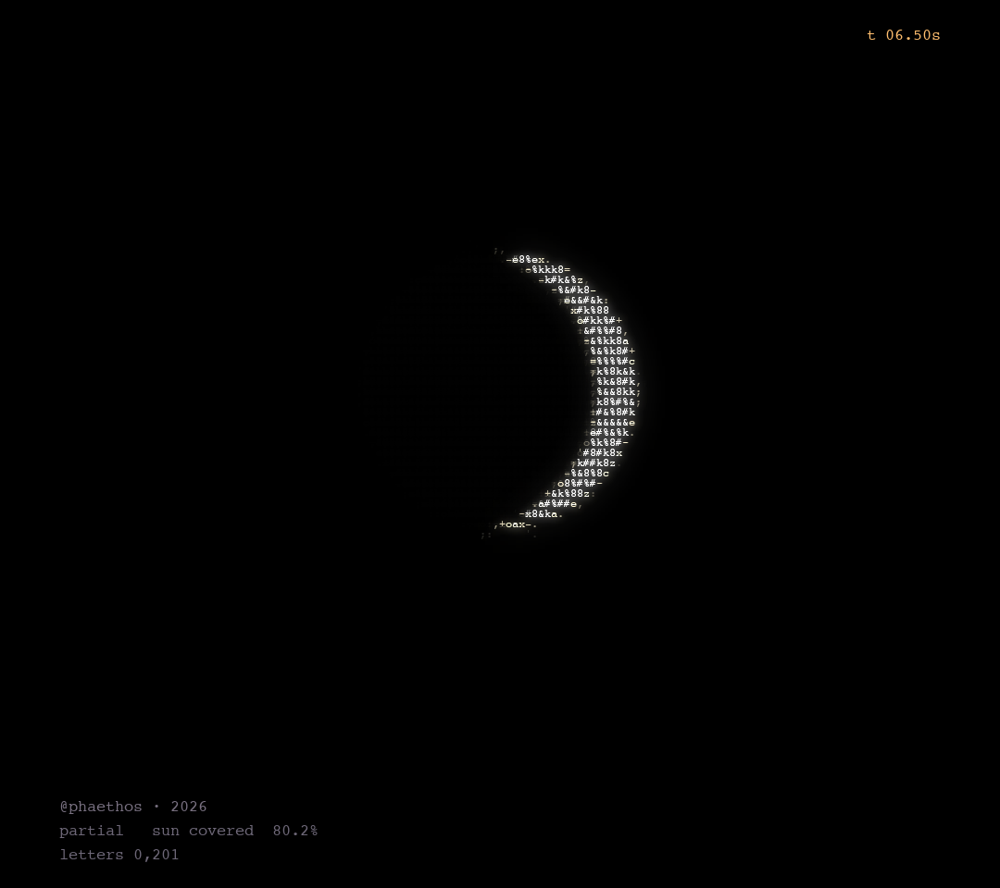
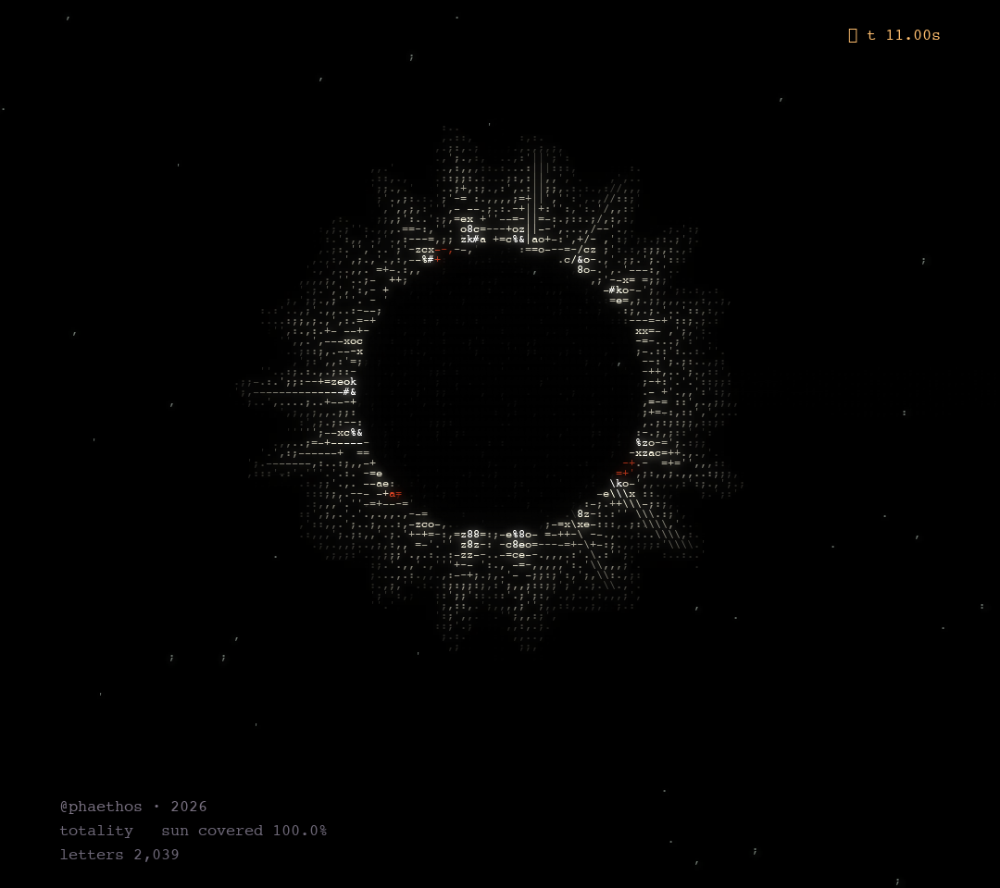
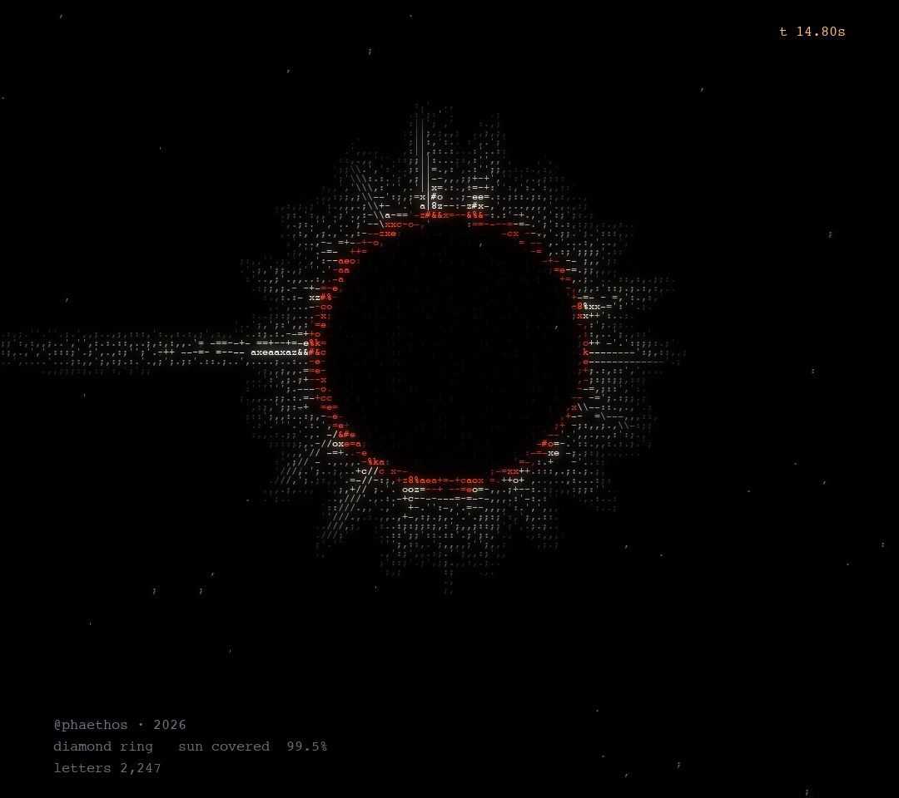

# SOLAR ECLIPSE

Solar Eclipse · ASCII code art by phaethos, 2026 · a fork addition, drawn in the spirit of JIN2



## Artist's Note

The moon slides in over the sun. The crescent narrows, the sky darkens,
the stars come out, and at totality the corona blooms with its streamers.
At the edges of totality the diamond ring flashes, and the red chromosphere
shows its rim. Then the moon slides out and the sun returns.
Everything is drawn only with letters, numbers and symbols.

| the crescent | totality | the diamond ring |
|---|---|---|
|  |  |  |

## Technology

Python · NumPy · pygame-ce

## Creative Process

1. Reference: eclipse photography - the silvery corona with its fine
   streamers and polar plumes, the diamond ring, the red chromosphere rim,
   the jagged lunar limb from mountains and valleys.
2. The moon's path is a table of waypoints with smooth easing, dwelling
   over the sun so totality can be watched.
3. The corona only exists during totality, and its streamers are drawn
   with letters along their own ray.

## Technical Concepts

Per-cell field rendering (no meshes) · waypoint-eased motion · jagged limb occlusion
Angular streamer ridges · ray-drawn letters · phosphor trail and glow pass

## Source Code

The full Python source is free and included in this folder.

```
pip install -r requirements.txt
python solar_eclipse.py
```

Space pause, R restart, S screenshot, Esc quit.
Free for personal projects. Please credit phaethos if you share what you make. See LICENSE.txt.

---

Artist: phaethos · [github.com/phaethos](https://github.com/phaethos)
© 2026 phaethos. All rights reserved.
