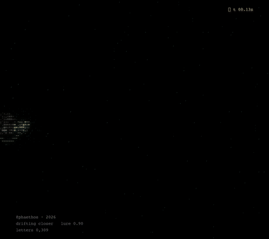
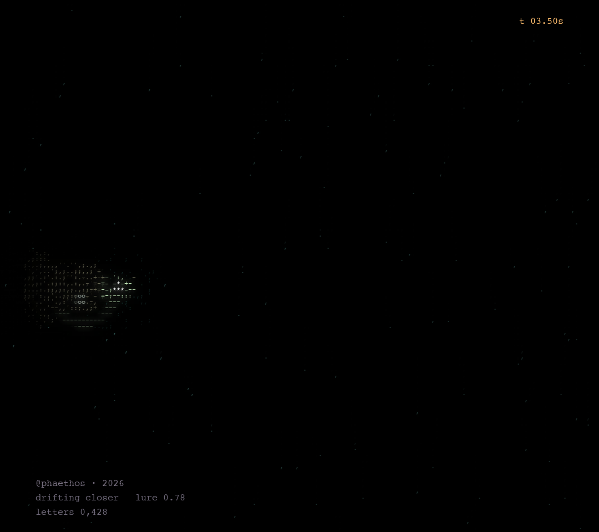
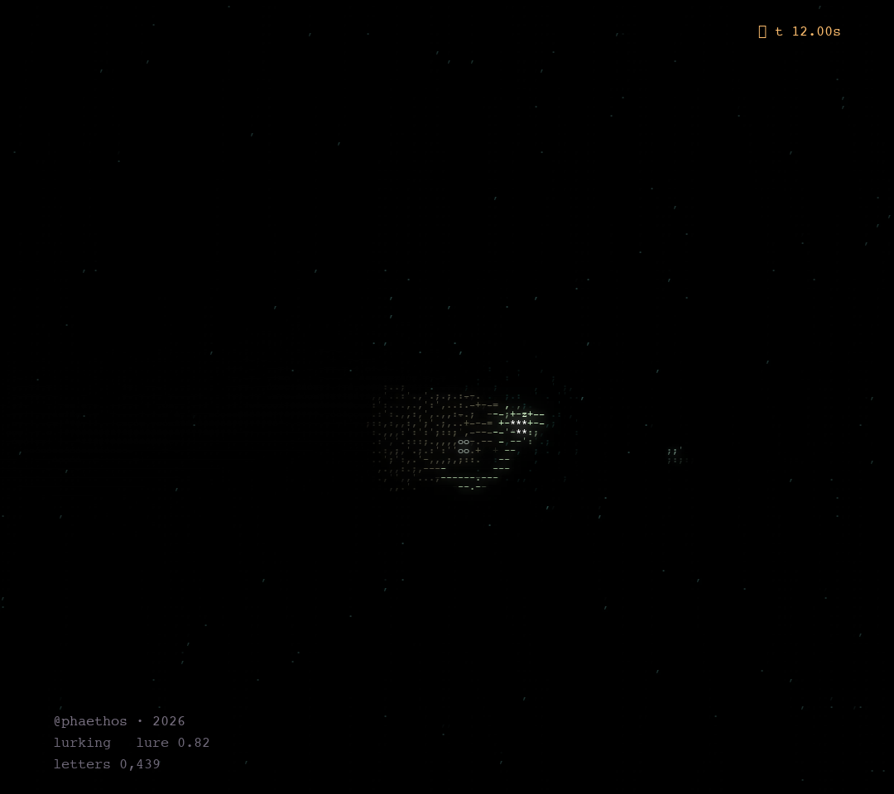
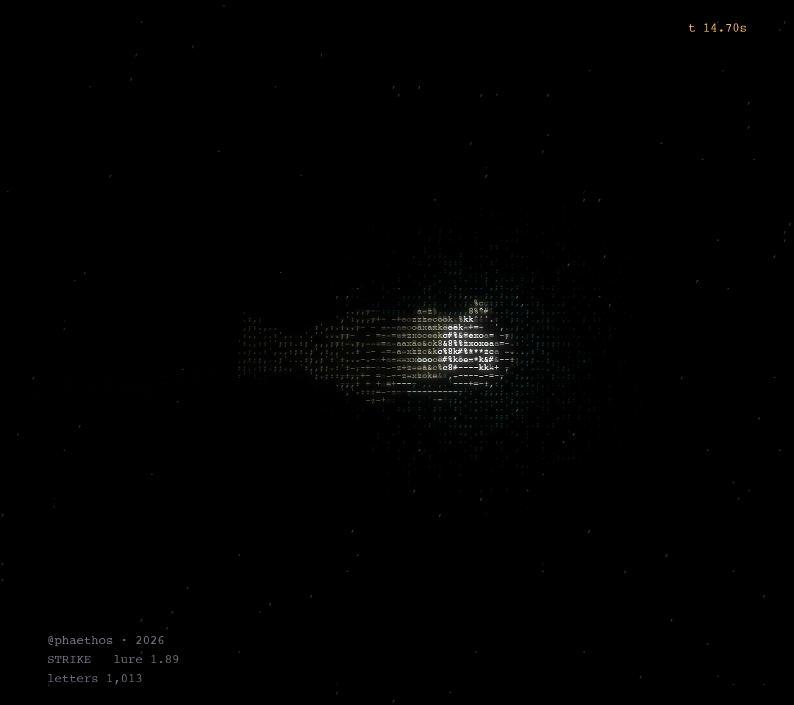

# THE ANGLER

The Angler · ASCII code art by phaethos, 2026 · a fork addition, drawn in the spirit of JIN2



## Artist's Note

Down where the sun has never been, an anglerfish drifts in out of the dark
with nothing visible but its lure. The fish is only there where the light
falls on it. Marine snow drifts through the glow and brightens as it passes.
A small curious fish comes to look - and the jaw snaps shut.
Everything is drawn only with letters, numbers and symbols.

| the lure | lurking | the strike |
|---|---|---|
|  |  |  |

## Technology

Python · NumPy · pygame-ce

## Creative Process

1. Reference: deep-sea footage of anglerfish - the esca's pulse, the
   illicium's curve, the huge jaw, and how little of the animal you ever see.
2. The fish is built from ellipses and wedges in its own coordinate frame:
   body, head, tail with sway, dorsal and pectoral fins, and a jaw that
   rotates open around a hinge.
3. The light rule is the whole piece: nothing of the fish is drawn unless
   the lure lights it.

## Technical Concepts

Per-cell field rendering (no meshes) · inverse-square-ish lure light
Procedural fish from ellipses and wedges · bezier illicium · particle marine snow

## Source Code

The full Python source is free and included in this folder.

```
pip install -r requirements.txt
python angler.py
```

Space pause, R restart, S screenshot, Esc quit.
Free for personal projects. Please credit phaethos if you share what you make. See LICENSE.txt.

---

Artist: phaethos · [github.com/phaethos](https://github.com/phaethos)
© 2026 phaethos. All rights reserved.
